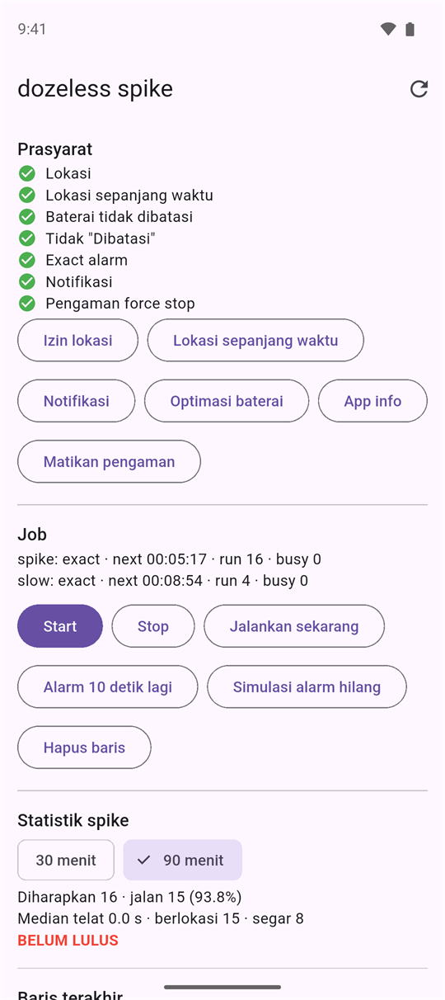
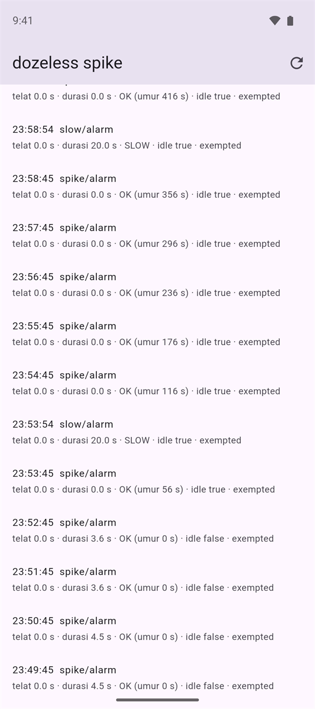
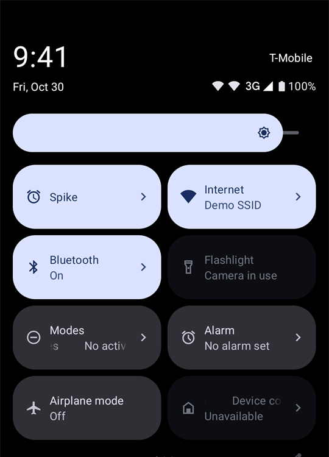
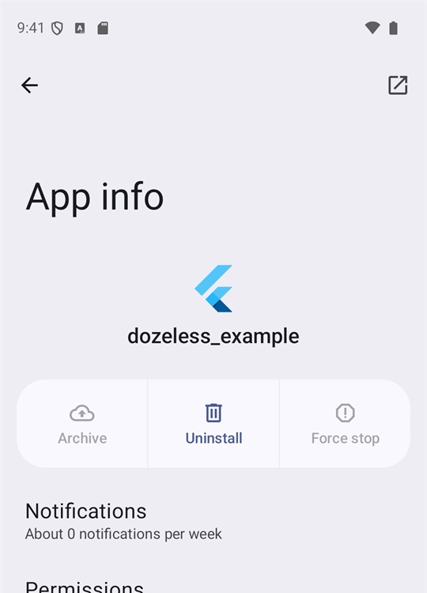

# dozeless

[](https://pub.dev/packages/dozeless)
[](https://github.com/xDaijobu/dozeless/actions/workflows/ci.yaml)
[](https://github.com/xDaijobu/dozeless/blob/main/LICENSE)


Background jobs for Flutter on Android that keep running while the phone sleeps: screen off, Doze, killed process, reboot, app update. Built only on `AlarmManager`: no WorkManager, no foreground service, no permanent notification. Your job logic stays in Dart.

```dart
@pragma('vm:entry-point')
Future<void> trackLocation(JobContext ctx) async {
  // runs every minute, even in Doze, in a background FlutterEngine
}

await Dozeless.schedule(id: 'track', callback: trackLocation, every: const Duration(minutes: 1));
```

<table>
  <tr>
    <td align="center"></td>
    <td align="center"></td>
    <td align="center"></td>
  </tr>
  <tr>
    <td align="center"><sub>Example app: prerequisites, jobs, statistics</sub></td>
    <td align="center"><sub>One row a minute while in Doze (<code>idle true</code>)</sub></td>
    <td align="center"><sub>Optional Quick Settings tile</sub></td>
  </tr>
</table>

<sub>Android 16 emulator (Pixel 9). The example app's UI is in Indonesian.</sub>

## Contents

- [Why](#why)
- [How it works](#how-it-works)
- [Tested](#tested)
- [Features](#features)
- [Install](#install)
- [Usage](#usage)
- [Surviving a force stop](#surviving-a-force-stop)
- [Reference](#reference)
- [Known limits](#known-limits)
- [Example app](#example-app)
- [Debugging](#debugging)
- [Tests](#tests)
- [Documentation](#documentation)
- [License](#license)

## Why

| Option | Problem |
|---|---|
| **WorkManager** | Periodic work runs at most every 15 minutes, and Doze defers it further. |
| **Foreground service** | Keeps a notification on screen for as long as it runs. |
| **`android_alarm_manager_plus`** | Does not wait for your callback, releases the wake lock too early, skips silently when exact alarms are denied, and its `periodic` alarms are not exact. |

## How it works

dozeless chains one-shot exact alarms (`setExactAndAllowWhileIdle`) per job. Every run goes like this:

1. The job's exact alarm fires, also in Doze.
2. dozeless arms the next alarm first, so a crash or a timeout never breaks the chain.
3. It takes a wake lock and calls your callback with a `JobContext` in a cached headless FlutterEngine, one run per job at a time.
4. It waits until the callback returns, throws or times out, records the status and releases the wake lock.

Around the chain, an hourly watchdog repairs lost or late alarms, and a receiver re-arms everything after boot, app update, clock changes and a force stop.

## Tested

Emulator results (Pixel 9 / Pixel 5 profiles, battery set to *Unrestricted*). Each ✅ means the job kept writing rows to the example app's database in that state.

| Condition | 11 | 12 | 13 | 14 | 15 | 16 |
|---|:-:|:-:|:-:|:-:|:-:|:-:|
| App open | ✅ | ✅ | ✅ | ✅ | ✅ | ✅ |
| App in background | ✅ | ✅ | ✅ | ✅ | ✅ | ✅ |
| Swiped away from Recents | ✅ | ✅ | ✅ | ✅ | ✅ | – |
| Process killed | ✅ | ✅ | ✅ | ✅ | ✅ | ✅ |
| Screen off | ✅ | ✅ | ✅ | ✅ | ✅ | ✅ |
| Doze (deep idle) | ✅ | ✅ | ✅ | ✅ | ✅ | ✅ |
| Reboot, app not opened | ✅ | ✅ | ✅ | ✅ | ✅ | ✅ |
| Force stop, then app opened | ✅¹ | ✅¹ | ✅¹ | ✅¹ | ✅¹ | ✅¹ |

¹ Android blocks every alarm of a force-stopped app until the user brings it back. That holds for every app. dozeless recovers as soon as the app is opened and reports the stop as a `processExit` event (`USER_REQUESTED`). See [Surviving a force stop](#surviving-a-force-stop) for ways back that do not need the app to be opened.

Raw evidence (databases written by the jobs, logcat, per-condition logs) is in [`doc/test-results/`](https://github.com/xDaijobu/dozeless/tree/main/doc/test-results). Real devices are still to be tested, starting with HyperOS.

## Features

- **Exact job chain** per job id (minimum interval 1 minute). Falls back to inexact alarms if exact alarms are denied.
- **Awaited Dart callback** with a timeout (≤ 50 s) and a partial wake lock. At most one run per job at a time.
- **Idempotent `schedule()`**: calling it on every app start never pushes the next run later.
- **Recovery** after reboot (`boot`), app update (`packageReplaced`), clock changes (`timeChanged`) and force stop. An hourly watchdog repairs lost or late chains.
- **Prerequisite gate.** When location, background location, battery *Unrestricted* or *not Restricted* go missing, the job stops, shows a notification and runs once with `prerequisiteLost`. Once fixed, it resumes with `resumed`.
- **Force-stop helpers** (opt-in): a Quick Settings tile that brings the app back without opening it, and a guard that disables Settings' "Force stop" button.
- **Rich `JobContext`**: trigger, how late the alarm fired, boot info, Doze, screen, standby bucket, ANDROID_ID, signal levels, and system events since the last run.

## Install

```bash
flutter pub add dozeless
```

Android only. `minSdk` 24. Developed with Flutter 3.47.6 / Dart 3.13.5.

The plugin adds `RECEIVE_BOOT_COMPLETED`, `SCHEDULE_EXACT_ALARM`, `WAKE_LOCK`, `ACCESS_WIFI_STATE`, its receivers and a start-up provider. Your app adds what its jobs need, for example:

```xml
<uses-permission android:name="android.permission.ACCESS_FINE_LOCATION" />
<uses-permission android:name="android.permission.ACCESS_COARSE_LOCATION" />
<uses-permission android:name="android.permission.ACCESS_BACKGROUND_LOCATION" />
<uses-permission android:name="android.permission.POST_NOTIFICATIONS" />
```

> **Warning:** do not use `android:installLocation="preferExternal"`: apps on external storage do not receive `BOOT_COMPLETED`.

## Usage

```dart
import 'package:dozeless/dozeless.dart';
import 'package:flutter/widgets.dart';

@pragma('vm:entry-point')
Future<void> getJob(JobContext ctx) async {
  if (ctx.trigger == JobTrigger.prerequisiteLost) {
    // record "tracking stopped", then return
    return;
  }
  // ctx.delayMs, ctx.device.deviceIdle, ctx.systemEvents, ctx.deadline …
}

Future<void> main() async {
  WidgetsFlutterBinding.ensureInitialized();
  await Dozeless.initialize(
    stopNotification: const StopNotification(
      title: 'Tracking stopped',
      body: 'Open the app to fix permissions or battery settings.',
    ),
  );
  await Dozeless.schedule(
    id: 'get',
    callback: getJob,
    every: const Duration(minutes: 5),
    requires: {Prereq.location, Prereq.backgroundLocation},
    timeout: const Duration(seconds: 45),
  );
  runApp(const MyApp());
}
```

- Callbacks must be top-level or static functions annotated with `@pragma('vm:entry-point')`. Closures are rejected with an `ArgumentError`.
- `Dozeless.initialize()` re-arms everything when the app starts and re-checks prerequisites every time the app is resumed. Call it before `runApp`.
- Other calls: `cancel(id)`, `status(id)`, `runNow(id)`, `checkPrerequisites()`, `openSettings(Setting)`, `disableForceStopGuard()`, and `debugFireIn`, `debugSimulateLostAlarm`, `debugRunWatchdog` for testing.

### Prerequisites

Battery *Unrestricted* and *not Restricted* are required for every job on every Android version. On Android 14+, battery *Unrestricted* is also what allows exact alarms, so the app never has to ask for `SCHEDULE_EXACT_ALARM`.

```dart
final p = await Dozeless.checkPrerequisites();
if (!p.batteryUnrestricted) await Dozeless.openSettings(Setting.batteryOptimization);
if (p.autostartSettingAvailable) await Dozeless.openSettings(Setting.autostart); // Xiaomi, Oppo, Realme, Vivo
```

| Prerequisite | Blocks jobs | How the user grants it |
|---|---|---|
| `location` | if the job requires it | runtime dialog |
| `backgroundLocation` | if the job requires it | Settings → "Allow all the time" |
| `batteryUnrestricted` | always | `Setting.batteryOptimization` or `Setting.appDetails` |
| `notBackgroundRestricted` | always | App info → Battery → not "Restricted" |
| `exactAlarm` | never (falls back to inexact) | granted by battery *Unrestricted* |
| `notification` | never | runtime dialog (Android 13+) |
| `forceStopGuard` | never | `Setting.forceStopGuard` (system dialog), see below |

## Surviving a force stop

A force stop (App info → **Force stop**, and on some brands swiping the app away or the OEM cleaner) puts the app in Android's *stopped state*: every alarm is deleted and nothing of the app runs until a **user action** brings it back. No app can undo that by itself, and Android 15 closed the remaining gaps. dozeless gives you three ways that stay within those rules:

| | What happens | Verified | Setup |
|---|---|---|---|
| **Recovery on unstop** | Opening the app, or any other user action that ends the stopped state, re-arms every job. On Android 15+ that includes actions that do not open the app: the system then sends `BOOT_COMPLETED`, and dozeless reconciles. | Android 16 | none |
| **Quick Settings tile** | Pulling down Quick Settings while the tile is visible starts the app process in the background and re-arms every job. The app is not opened. | Android 16 | declare the service; the user adds the tile once |
| **Force-stop guard** | A device admin without policies. While it is active, Settings disables the app's **Force stop** button. | Android 16 | declare the receiver; the user activates it once |

<table>
  <tr>
    <td align="center"></td>
    <td align="center"></td>
  </tr>
  <tr>
    <td align="center"><sub>The tile in Quick Settings</sub></td>
    <td align="center"><sub>Force-stop guard on: <b>Force stop</b> is disabled</sub></td>
  </tr>
</table>

"Verified" means checked on the Android 16 emulator, a few minutes per case. The planned one-hour runs per condition were cut short; what was measured, and how to rerun them, is in [`doc/test-results/FORCE-STOP.md`](https://github.com/xDaijobu/dozeless/blob/main/doc/test-results/FORCE-STOP.md) (Indonesian).

### Quick Settings tile

Declare the tile in your app's `AndroidManifest.xml` and give it an icon and a label:

```xml
<service
    android:name="io.github.xdaijobu.dozeless.DozelessTileService"
    android:exported="true"
    android:icon="@drawable/ic_tile"
    android:label="Tracking"
    android:permission="android.permission.BIND_QUICK_SETTINGS_TILE">
    <intent-filter>
        <action android:name="android.service.quicksettings.action.QS_TILE" />
    </intent-filter>
</service>
```

The user adds it once from the Quick Settings editor (pencil icon). From then on, every time Quick Settings opens with the tile on screen, and every time the tile is tapped, dozeless reconciles the jobs. The tile is active while every job runs, inactive when a job stopped for a missing prerequisite, and unavailable when no job is scheduled.

### Force-stop guard

Declare the receiver in your app's `AndroidManifest.xml`. The label and the description are what the system dialog shows:

```xml
<receiver
    android:name="io.github.xdaijobu.dozeless.DozelessAdminReceiver"
    android:description="@string/force_stop_guard_description"
    android:exported="true"
    android:label="@string/force_stop_guard_label"
    android:permission="android.permission.BIND_DEVICE_ADMIN">
    <meta-data
        android:name="android.app.device_admin"
        android:resource="@xml/dozeless_device_admin" />
    <intent-filter>
        <action android:name="android.app.action.DEVICE_ADMIN_ENABLED" />
    </intent-filter>
</receiver>
```

```dart
final p = await Dozeless.checkPrerequisites();
if (p.forceStopGuardAvailable && !p.forceStopGuard) {
  await Dozeless.openSettings(Setting.forceStopGuard); // system dialog, needs the app in the foreground
}
// later, for example on sign-out:
await Dozeless.disableForceStopGuard();
```

What to know before you use it:

- It only disables the **Force stop** button in Settings. `adb shell am force-stop`, task killers and OEM cleaners that force-stop apps directly are not affected.
- Android does not let the user uninstall an app with an active device admin. They have to turn it off first (Settings → Security → Device admin apps), or the app calls `disableForceStopGuard()`.
- The admin uses no policies (`res/xml/dozeless_device_admin.xml` in the plugin), so it cannot lock, wipe or watch the device. Google Play still reviews apps that declare a device admin; check its policy before you ship it in a store build.
- If the app is the **device owner** (company-owned phones provisioned through an MDM or `dpm set-device-owner`), dozeless also calls `setUserControlDisabledPackages` on Android 11+, which blocks force stop and clear data on every Settings page. Not tested yet.

## Reference

### JobContext

| Field | Meaning |
|---|---|
| `trigger` | `alarm` · `boot` · `watchdog` · `packageReplaced` · `timeChanged` · `prerequisiteLost` · `resumed` · `manual` |
| `scheduledAt`, `firedAt`, `delayMs` | when the alarm was due, when it fired, how late |
| `timeout`, `deadline` | stop working before `deadline`; the plugin gives up there |
| `mode` | `exact` · `inexact` · `stopped` |
| `boot` | `bootCount`, `bootTime`, `firstJobSinceBoot` |
| `systemEvents` | events since this job's last successful run (delivered again if the run fails) |
| `prerequisites`, `device` | snapshots taken just before the run |
| `lastRunAt`, `lastError`, `stoppedAt` | previous run, and when a resumed job had stopped |

### System events

| `type` | `data` |
|---|---|
| `boot` | `bootCount`, `bootTime`, `shutdownAt`, `shutdownSource` (`marker` · `lastJob` · `unknown`), `viaBroadcast` |
| `timeChanged` | `jumpMs`, `autoTime` |
| `timezoneChanged` | `from`, `to` |
| `processExit` | `reason` (`USER_REQUESTED` = force stop, `LOW_MEMORY`, `CRASH`, …), `reasonCode`, `importance`, `description` |

### `JobStatus.lastError`

| Value | Meaning |
|---|---|
| `JOB_TIMEOUT` | the callback did not finish in time; later runs are skipped as busy until it returns or 3× the timeout passes |
| `JOB_FAILED: …` | the callback threw |
| `CALLBACK_NOT_FOUND: …` | the callback handle is not in this build |
| `ENGINE_START_FAILED: …` | the app was never opened since install, or the dispatcher was not ready within 15 s |

## Known limits

- **Force stop** stops everything until a user action brings the app back (Android rule, see [Surviving a force stop](#surviving-a-force-stop)).
- **Xiaomi/HyperOS and other OEMs** may treat "swipe away" or their cleaner like a force stop, and may block `BOOT_COMPLETED` without Autostart. Ask users to enable Autostart and lock the app in Recents.
- **Location in the background can be stale.** Android 8+ gives background apps a fresh location only a few times per hour, so `getCurrentPosition` may return a cached fix with no error. Record the fix time and treat old fixes as stale.
- Runs of different jobs in one process are serialized by Android's broadcast queue. Keep timeouts short.

## Example app

[`example/`](https://github.com/xDaijobu/dozeless/tree/main/example) is the feasibility app used for every test above. Two jobs write a row to `spike.db` on every run: `spike` every minute (location, delay, Doze, screen, fix age) and `slow` every 5 minutes (awaits 20 seconds to prove the wake lock holds). The screen shows the prerequisites with buttons to fix them, job status, statistics for the 90-minute screen-off test and the latest rows. It declares both force-stop helpers.

```bash
cd example
flutter build apk --debug && adb install -r build/app/outputs/flutter-apk/app-debug.apk
adb shell dumpsys deviceidle whitelist +io.github.xdaijobu.dozeless_example
```

## Debugging

```bash
adb logcat -s Dozeless:I flutter:I
adb shell dumpsys alarm | grep -A4 "^ *tag=.*dozeless.RUN"       # one alarm per job
adb shell dumpsys alarm | grep -A4 "^ *tag=.*dozeless.WATCHDOG"  # hourly watchdog
adb shell dumpsys package <package> | grep -m1 stopped=           # stopped=true after a force stop
adb shell dumpsys deviceidle whitelist +<package>                 # battery Unrestricted, for tests
adb shell dumpsys deviceidle force-idle                           # force Doze (screen off, unplugged)
```

Job callbacks run in a separate engine, so hot reload does not reach them. Use hot restart or kill the app process after changing a job.

## Tests

```bash
flutter test                                  # Dart API, models, dispatcher
cd example && flutter test                    # example statistics
cd example && flutter build apk --config-only && cd android && ./gradlew :dozeless:testDebugUnitTest   # Kotlin (JDK 17+)
cd example && flutter test integration_test/dozeless_test.dart -d <device> --no-uninstall
```

Integration tests need battery *Unrestricted* for the example app (`adb shell dumpsys deviceidle whitelist +io.github.xdaijobu.dozeless_example`). `--no-uninstall` keeps that setting between runs.

## Documentation

[`doc/`](https://github.com/xDaijobu/dozeless/tree/main/doc) on GitHub is in Indonesian: the design spec, the implementation plan (task by task, TDD), test results per Android version, and a one-page summary (`doc/ringkasan.html`). It is not part of the pub.dev package.

## License

[Apache License 2.0](https://github.com/xDaijobu/dozeless/blob/main/LICENSE).
